# 法语学习语库 · Bonjour A1–C1

面向「只会蹦单词、阅读长文吃力、听力跟不上、语法薄弱」的 A1–B2 学员。两套语料打底——
**核心语库 A1–B2** 与 **情景口语语库**——上面盖了八类训练、四个小游戏、一套间隔复习和一套升级系统。


**在线版（GitHub Pages）**：<https://raitoku.github.io/french-learn/> · 
零依赖、纯静态：不安装、不联网、不构建，双击即用。

## 视觉语言：黄黑标识系统

低饱和淡色系，一套配色走到底，全站零渐变、零毛玻璃：层次只靠**实色 + 墨线边框 + 偏移硬阴影**。

| 角色 | 色值 | 用法 |
| --- | --- | --- |
| 底色 | `#f6f1e6` | 页面底，低饱和暖白 |
| 卡片 | `#fdfbf5` | 所有内容块（比底色略亮，不刺眼） |
| 墨 | `#3b3629` | 文字、边框、阴影（暖深灰，非纯黑） |
| 主色 | `#e2bb63` | 主按钮、激活态、图标底、计时条、进度——**淡黄底永远配墨字** |
| 语义红 | `#b3574c` | 只用于错误 / 删除 |
| 语义绿 | `#4f7a5b` | 只用于正确 / 完成 |
| 夜间 | `#17150f` + `#d8b878` | 深色模式（暖褐夜间） |

要点：

- **学习区和游戏区是同一套配色**，游戏只是结构更"机台"（HUD 三宫格、分段计时条、评级结算 S/A/B/C），不再切深色主题，避免割裂。
- **Logo**：黄色圆角方块 + 墨色几何 `F` + 句点，2px 墨边 + 偏移阴影；favicon 同步成同一枚标记。
- **图标**：游戏与训练入口全部换成墨色线性 SVG（方块拼图 / 闪电 / 耳机 / 积木 / 铅笔 / 勾选框），画在黄底方块上，不再用彩色 emoji。
- 法文用衬线（Iowan / Georgia），数字用等宽，中文无衬线；标题字距收紧，微标签全大写 + 0.14em 字距。
- 交互统一：按下位移 2px、阴影消失，像实体键。

## 界面预览

| 首页（手机） | 词汇（6,998 词） | 桌面 | 语法字典 |
| --- | --- | --- | --- |
|  | 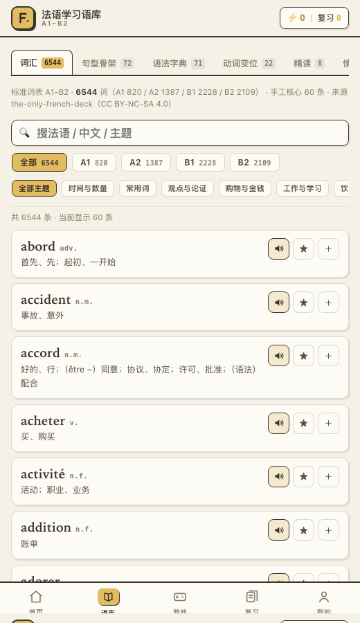 | 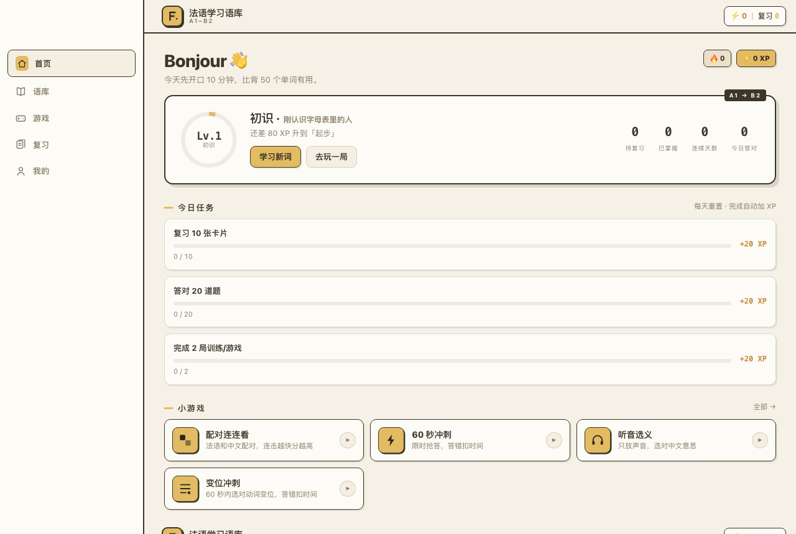 | 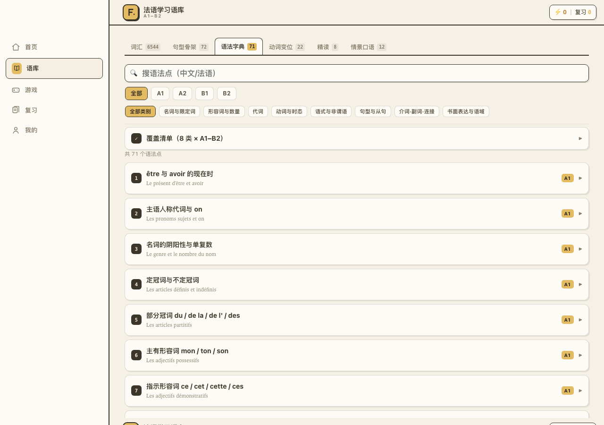 |

| 游戏中心 | 配对连连看 | 结算评级 | 情景口语 |
| --- | --- | --- | --- |
| 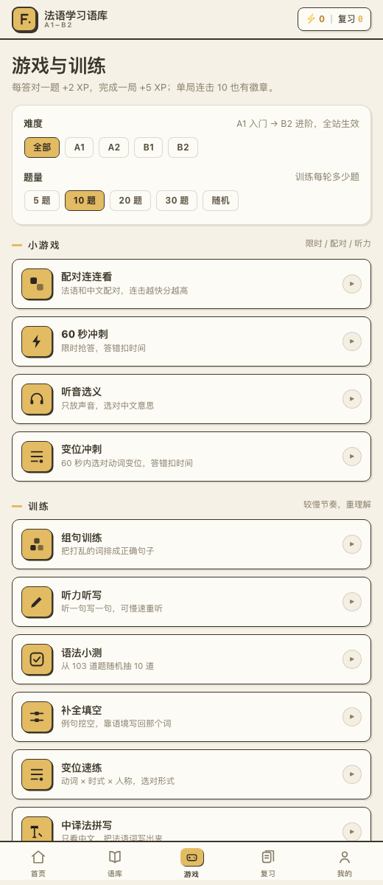 | 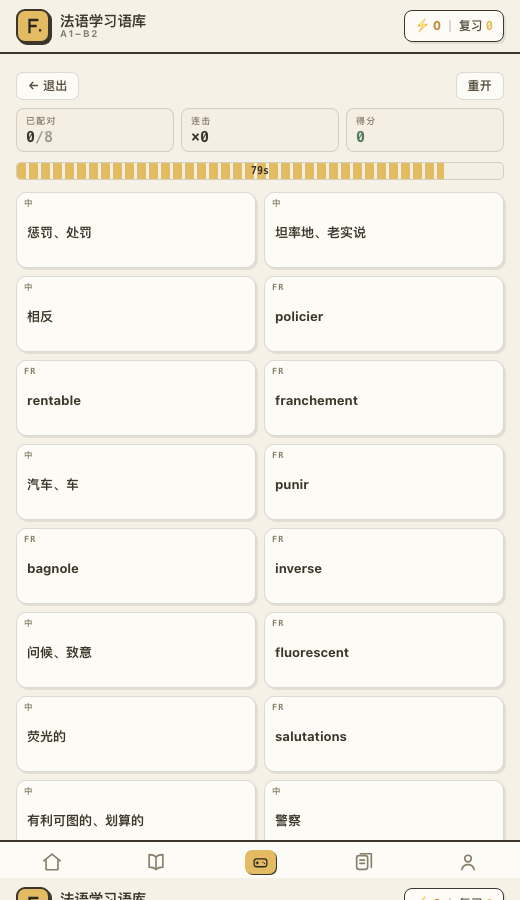 | 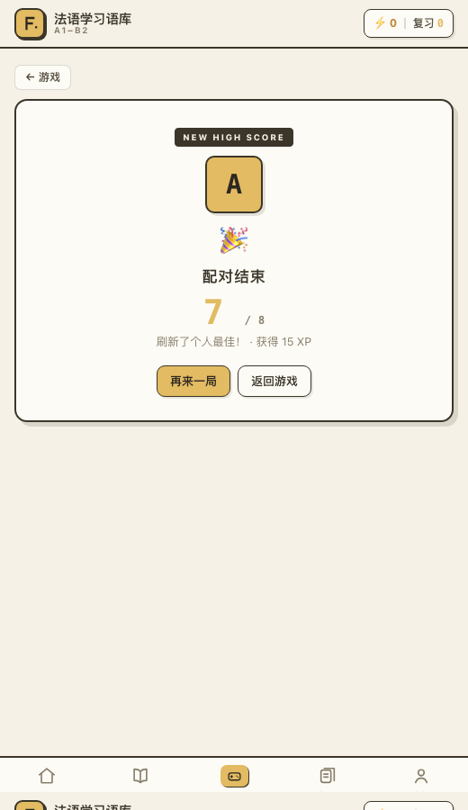 | 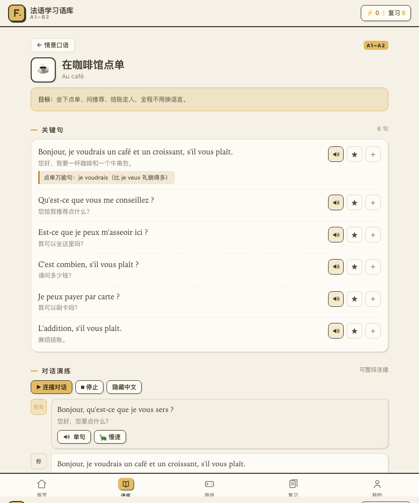 |

| 变位冲刺 | 补全填空 | 快判对错 | 综合挑战 |
| --- | --- | --- | --- |
| 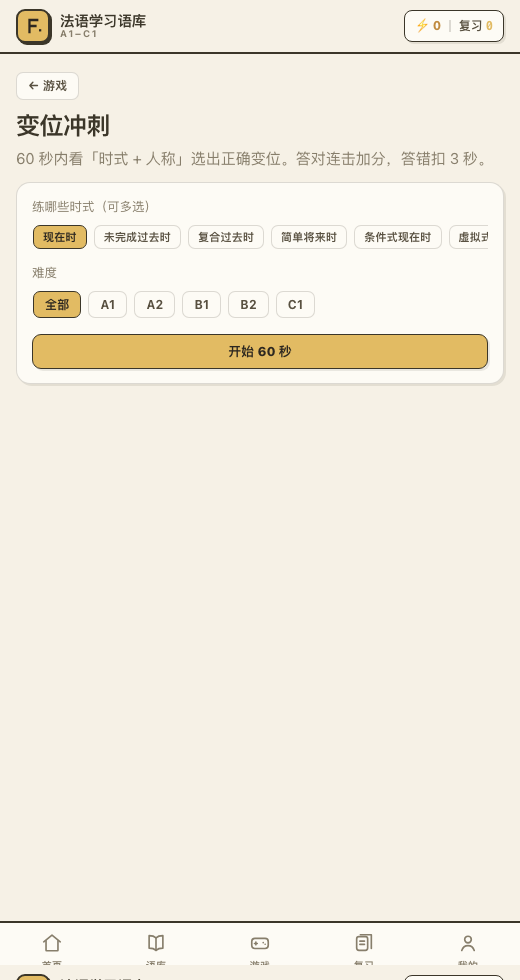 | 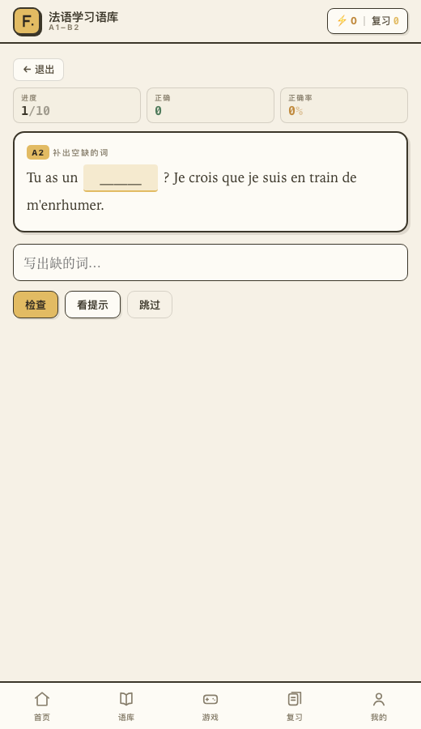 | 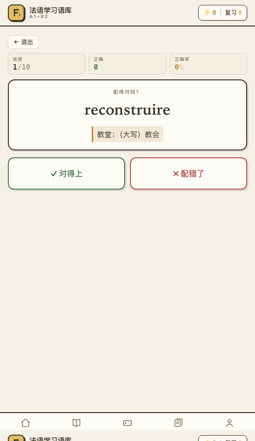 | 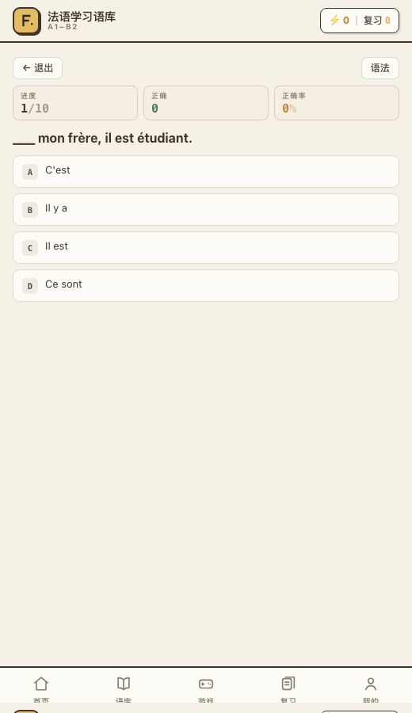 |

| 变位速练 | 中译法拼写 |
| --- | --- |
| 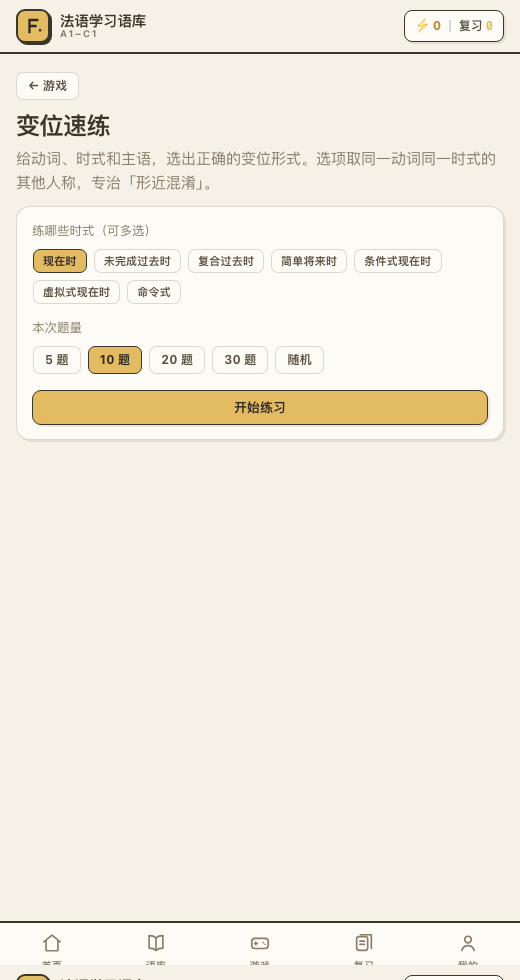 | 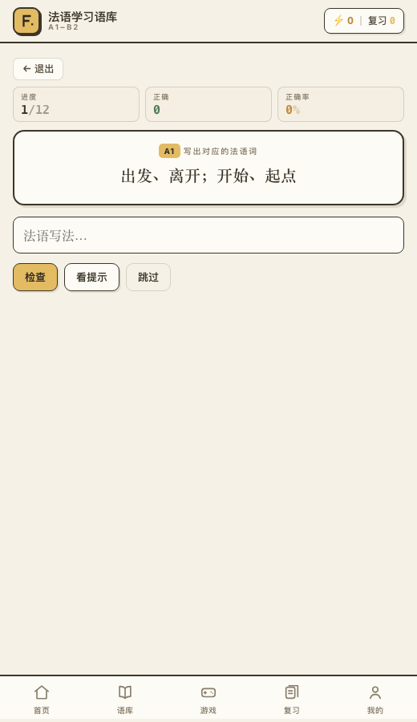 |
| 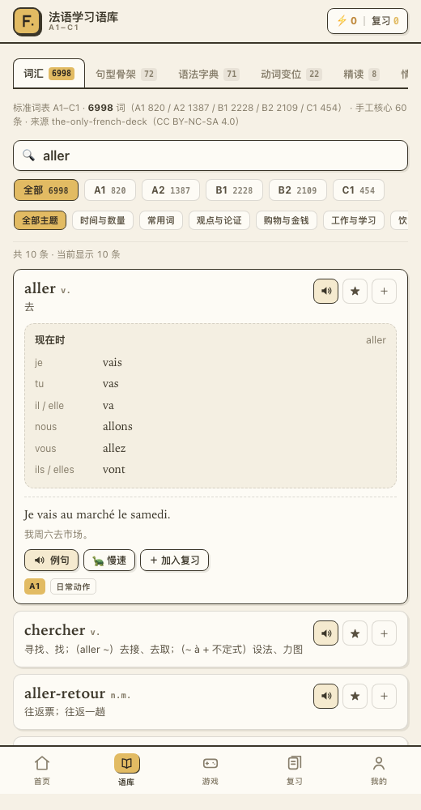 | |

| 动词变位 | 复习闪卡 | 我的 |
| --- | --- | --- |
| 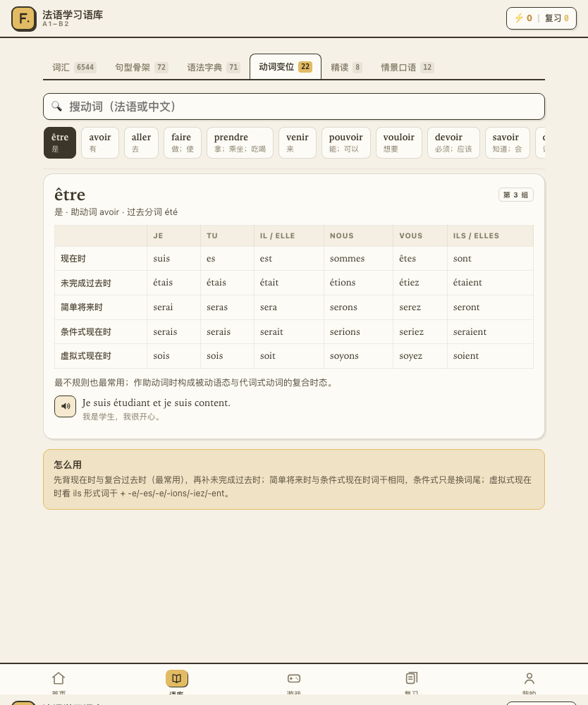 | 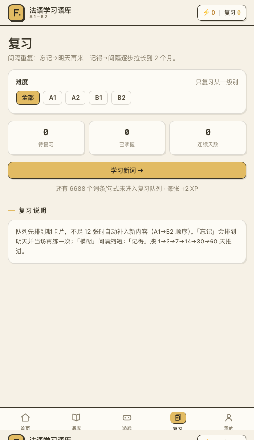 | 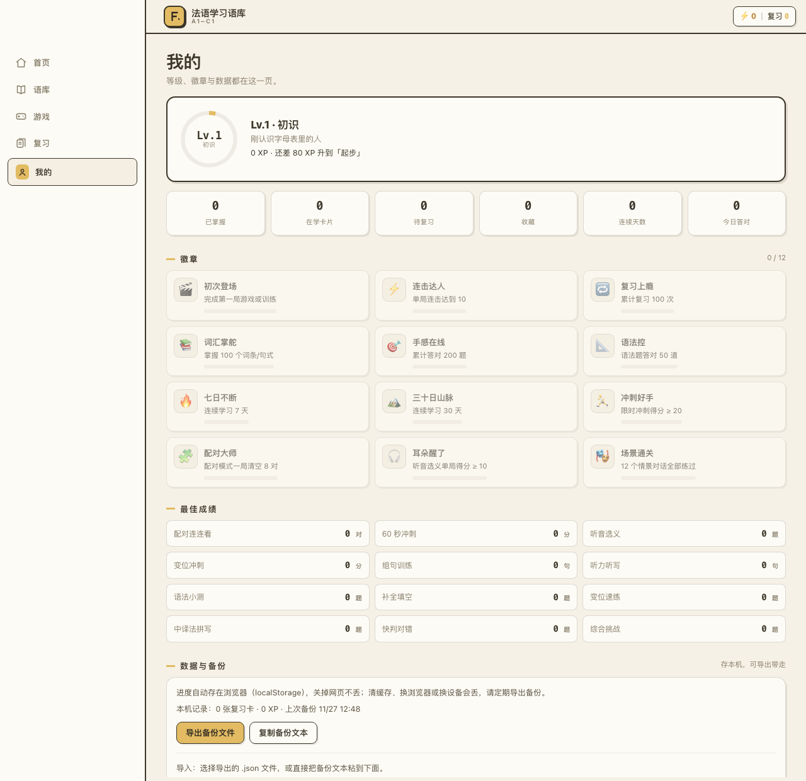 |

## 性能：语料懒加载

6,998 条词汇如果一次性同步加载要 1.5MB，首屏会被它拖住。现在拆成按级别（首屏只拉 A1 那 160KB）：

| 级别 | 文件 | 体积 | 何时加载 |
| --- | --- | --- | --- |
| A1 | `data/lexicon-a1.js` | 165KB | 随页面同步（首屏就有内容） |
| A2 | `data/lexicon-a2.js` | 294KB | 空闲时自动预载，或选中 A2 时 |
| B1 | `data/lexicon-b1.js` | 486KB | 同上（A2 载完后接着载） |
| B2 | `data/lexicon-b2.js` | 456KB | 同上 |
| C1 | `data/lexicon-c1.js` | 91KB | 同上（最后载入） |
| 变位池·基础 | `data/verb-forms.js` | 396KB | 进「变位速练 / 变位冲刺」时载入（1,351 个动词：现在时 / 复合过去时 / 未完成过去时 / 命令式） |
| 变位池·进阶 | `data/verb-tenses.js` | 285KB | 选中「将来时 / 条件式 / 虚拟式」时才额外加载（1,351 个动词） |

- 级别 chip 在对应数据还没到时是**虚线圈 + 载入**态，载完自动点亮并显示词数
- 搜索、复习、训练、游戏需要全量语料时，会先补载缺失级别并提示「正在载入 A2 / B1 …」，就绪后再开始，不会只拿 A1 的一半数据
- 词卡校验按级别跳过未载入的部分，**不会**因为懒加载误删 A2–B2 的复习记录
- 语料部分首屏只付 160KB（A1）+ 0.8KB（meta），全量 1.8MB 按需流式补齐；`file://` 双击打开同样生效（脚本注入不走 fetch）

## 打开方式

- 直接双击 `index.html`（file:// 可运行：语料是 `window.FR.*` 全局对象，不走 fetch）。
- 或起本地服务（便于手机/平板访问同一台电脑）：

```bash
cd french-learn
python3 -m http.server 8899
# 浏览器打开 http://127.0.0.1:8899
```

朗读用浏览器内置 `speechSynthesis`（macOS Chrome 调系统法语语音 "Google français / fr-FR"）。无声就先点一次任意朗读按钮，并确认系统装了法语语音包。

## 三端自适应

| 断点 | 布局 |
| --- | --- |
| < 640px（手机） | 底部 5 键导航 + 单列卡片；安全区（刘海屏 `env(safe-area-inset)`）已处理 |
| 640–1023px（iPad 竖屏 / 平板） | 内容居中 760px，游戏卡 3 列，统计 6 列，变位表横向滚动 |
| ≥ 1024px（iPad 横屏 / 桌面） | 左侧固定侧栏 + 内容区 1080px，游戏卡 3 列，徽章 3 列 |

同一条路由在三种宽度下都能完整操作：点读、连播、拖词组句、限时抢答都只用点击/触摸，无悬停依赖。

## 词表从哪来

不是自撰，也不是机器翻译，来自开源 Anki 卡组 [the-only-french-deck](https://github.com/bonorca/the-only-french-deck)（CC BY-NC-SA 4.0）。它的上游依据是 **Wiktionary OpenSubtitles 词频 Top20K** + **CLE 教材 A1–B2 生词** + **FLELex（UCLouvain CENTAL）分级频次**；中文释义、法语例句与变位都在卡组里。

本项目做的是：按 CECR 拆级（A1–C1）、去重、释义清洗、主题归类、以及把卡组的 1,351 个动词扩成七种时式练习池（推导规则见 `scripts/build-verb-tenses.py`，与手工 22 词表逐项对齐）。复现：`FRDECK=<卡组 tracking 目录> python3 scripts/import-deck.py && python3 scripts/build-verb-tenses.py`。详见 `NOTICE.md`。

## 内容清单

| 语库 | 规模 | 说明 |
| --- | --- | --- |
| 核心语库 · 词汇 | **6,998 条**（A1 820 / A2 1,387 / B1 2,228 / B2 2,109 / C1 454） | 按标准分级词表导入：词性、中文释义、法语例句 + 中文翻译、主题标签；搜索只命中词形与释义，动词详情带现在时变位（含代词式） |
| 核心语库 · 句型骨架 | 72 句 / 11 类交际功能 | 开口过渡、没听懂、卡词、观点、举例、对比、同意反对、委婉拒绝、请求建议、收尾、长句骨架 |
| **语法字典** | **71 个语法点**（A1 20 / A2 20 / B1 17 / B2 14）× 8 大类，103 道随堂题 | 讲解 + 变位/对比表 + 分级例句 + 易错提示 + 随堂题解析 |
| **动词变位速查** | 22 个高频动词 × 5 个时式（现在时 / 未完成过去时 / 简单将来时 / 条件式现在时 / 虚拟式现在时） | 助动词、过去分词、组别，代词式动词单列；含 3 个规则动词范例 |
| 核心语库 · 精读 | 8 篇（每级 2 篇） | 逐句点读、整篇连播、译文折叠、生词卡、理解题 |
| 情景口语语库 | 12 个场景 / 72 关键句 / 100 轮对话 | 点单、买票、酒店、问路、市场、试衣、药店、租房、面试、投诉、社交、电话 |

**词汇覆盖怎么核对**：词表按 A1–B2 分级导入（分级依据 FLELex / CLE 教材 / Wiktionary 词频，见 [NOTICE.md](NOTICE.md)），词库页顶部直接写着各级条数与来源；等级筛选按钮上也带数量，一眼能看出哪一级有多少词。

**语法覆盖怎么核对**：语法字典顶部有「覆盖清单（8 类 × A1–B2）」折叠表，按类别统计各等级条目数，点开即可核对哪一格是几项、有没有空缺——覆盖不是口头承诺，是页面里能数的。8 类为：名词与限定词 / 形容词与数量 / 代词 / 动词与时态 / 语式与非谓语 / 句型与从句 / 介词·副词·连接 / 书面表达与语域，对齐 A1–B2 教学大纲（Référentiels / DELF 语法项目）的知识点划分，不收录超出 B2 的冷僻内容。

## 功能

**难度与题量**：全站一个 A1 / A2 / B1 / B2 / 全部 选择器（游戏中心、各游戏与训练、复习页都有），旁边还有 **题量** 选择（5 / 10 / 20 / 30 / 随机）。两者都存在本地设置里，下次打开还是上次选的；「随机」每次给 6–20 题，同一套题库每轮抽的内容、顺序、选项都不一样。

**点击特效**：任何按钮/选项/卡片按下都有水波纹；答对飘 `+N` 绿字并轻微闪绿，答错闪红＋抖动；连击时数字变琥珀色。尊重 `prefers-reduced-motion`。

**导航**：首页 / 语库 / 游戏 / 复习 / 我的。语库内含六个子库：词汇、句型骨架、语法字典、动词变位、精读、情景口语。

- **首页**：等级环 + XP、今日任务（3 条，完成自动加 XP）、小游戏与训练入口、A1–B2 掌握度、徽章、情景入口。
- **词汇**：等级 + 主题筛选、关键词搜索（法语/中文/例句）、展开看例句、收藏、加入复习队列。
- **语法字典**：等级 + 8 大类筛选、关键词搜索、覆盖清单、手风琴展开（讲解/表格/例句朗读/易错/随堂题即时判定）。
- **动词变位**：搜索动词、点选查看五时式六人位全表，配用法说明与例句朗读。
- **精读**：点句朗读、整篇连播、显示/隐藏译文、生词卡、理解题。
- **情景口语**：关键句（含用法提示）→ 对话连播（逐句高亮）→ 高频词 → 文化提示。
- **小游戏**（每答对 +2 XP，完成一局 +5 XP，全清再 +10）：
  - 配对连连看：法↔中配对，90 秒，组数随题量（4–10 组），连击加成。
  - 60 秒冲刺：看词选义，答错扣 3 秒。
  - 听音选义：只播放法语，选中文意思，可慢速重听。
  - **变位冲刺**：60 秒内看「时式 + 人称」选变位，答错扣 3 秒，连击翻倍
- **训练**（八种）：
  - **组句**：看中文把打乱的词排成一句话
  - **听写**：听一句写一句（判分忽略大小写/重音/标点，可慢速重听、看提示）
  - **语法小测**：从 103 题随机抽 N 道，答错给解析
  - **补全填空**：真实例句挖掉一个词，靠语境写回来（4,712 条例句可用）
  - **变位速练**：22 动词 × 5 时式 × 6 人称；选项＝同时式他人称 ×2 + 其他时式 ×1
  - **中译法拼写**：只给中文，把法语词写出来——练主动产出
  - **快判对错**：词 + 中文释义，判断配得对不对，凭直觉提速
  - **综合挑战**：五种题型随机混排，每次打开顺序和题型都不同
- **复习**：间隔重复（1→3→7→14→30→60 天），到期优先、不足 12 张补新内容，「忘记」次日再来并当场重练。
- **成长**：XP → 9 级（初识 → 备考选手）、每日任务、12 枚徽章（首局、连击 10、复习 100、掌握 100、答对 200、语法 50、连续 7/30 天、冲刺 20 分、配对全清、听音 15、12 场景通关）、十二项最佳成绩。
- **我的**：等级、统计、徽章、最佳成绩、朗读语速、「情景对话默认隐藏中文」。
- **数据与备份**（我的 → 数据与备份）：
  - 进度自动存在浏览器 localStorage，关页面不丢；每次打开/切走/关闭还会另存一份**自动备份**（第二个键），主记录损坏或误清可一键回滚。
  - **导出**：下载 `frlearn-日期.json`，或「复制备份文本」（iOS/受限环境下载被拦时用这条）。
  - **导入**：选文件或粘贴文本，先显示摘要（多少卡、多少 XP、备份时间）再确认覆盖。
  - 清空进度前会先自动留一份备份；检测到 localStorage 不可写（file:// 受限、隐私模式）时会在页面顶部明确提示。

进度只存在本机 localStorage（主键 `frlearn.v2`、自动备份键 `frlearn.backup.v2`，旧版 `frlearn.v1` 会自动迁移），不上传服务器。浏览器清缓存、换设备会丢，**请在「我的 → 数据与备份」定期导出**。

### 语料来源与许可

词汇分级、中文释义与例句来自 [the-only-french-deck](https://github.com/bonorca/the-only-french-deck)（CC BY-NC-SA 4.0，非商业使用，需署名、相同方式共享），分级依据 FLELex / CLE 教材 / Wiktionary 词频；手写核心词条、句型、语法、变位、精读、情景对话为本项目自撰。详见 [NOTICE.md](NOTICE.md)。

## 目录结构

```
french-learn/
├── index.html            应用外壳（顶栏、路由容器、5 键导航）
├── css/style.css         设计系统（三端断点 + 深色模式）
├── data/                 语料（纯 JS 全局对象，无构建）
│   ├── lexicon-meta.js   FR.LEXICON_META 总量与来源（0.8KB，始终加载）
│   ├── lexicon-a1.js     FR.LEXICON.A1  820 条（165KB，随页面同步加载）
│   ├── lexicon-a2.js     FR.LEXICON.A2  1,387 条（懒加载，选中/空闲时载入）
│   ├── lexicon-b1.js     FR.LEXICON.B1  2,228 条（同上）
│   ├── lexicon-b2.js     FR.LEXICON.B2  2,109 条（同上）
│   ├── lexicon-c1.js     FR.LEXICON.C1  454 条（同上，最后载入）
│   ├── verb-forms.js     1,351 动词 × 现在时/复合过去时/未完成过去时/命令式
│   ├── verb-tenses.js    1,351 动词 × 将来时/条件式/虚拟式（按选择加载）
│   ├── frames.js         FR.FRAMES       句型骨架
│   ├── grammar.js        FR.GRAMMAR + FR.GRAMMAR_META  语法点 / 分类 / 覆盖基准
│   ├── verbs.js          FR.VERBS + FR.VERB_TENSES     变位表
│   ├── readings.js       FR.READINGS     精读篇目
│   └── scenarios.js      FR.SCENES       情景对话
├── scripts/              维护脚本
│   ├── import-deck.py    从卡组 TSV 生成分级词表（A1–C1）
│   ├── build-verb-tenses.py  推导七种时式，并用 data/verbs.js 做回归校验
│   └── deploy-pages.sh   建仓库 + 推送 + 开启 Pages（需 gh 已认证）
├── docs/                 界面截图
└── js/
    ├── util.js           工具（转义、稳定洗牌、归一化判分、句切分、toast）
    ├── store.js          localStorage 进度 + 间隔重复 + XP/等级/任务/徽章
    ├── speech.js         语音合成封装（单句 / 顺序队列 / epoch 令牌）
    ├── views-core.js     首页、语库 tab、词汇、句型骨架、精读
    ├── views-grammar.js  语法字典、覆盖清单、动词变位、通用题目渲染
    ├── views-scenes.js   情景口语列表与详情
    ├── views-drills.js   组句 / 听写 / 语法小测 / 填空 / 变位 / 拼写
    ├── views-games.js    游戏中心 / 配对 / 冲刺 / 听音
    ├── views-review.js   复习闪卡、我的（等级·徽章·设置）
    └── app.js            目录索引、hash 路由、渲染、事件委托
```

## 扩充语料

数据都是普通数组，往对应文件里加即可，新增内容会自动进入筛选、训练与复习池。

```js
// 词汇（th 为主题自动归类结果，可手工改写）
{w:'gare', p:'n.f.', cn:'火车站', ex:'La gare est à dix minutes à pied.', exCn:'火车站步行十分钟。', th:'出行与旅行'}

// 语法点（a 为正确项下标；选项渲染时按题干稳定打乱，不必手改下标）
{id:'g-b2-15', lv:'B2', cat:'句型与从句', fr:'La concession', title:'让步进阶',
 point:'…', table:{head:['','si 从句','主句'], rows:[…]}, ex:[{fr:'…', cn:'…'}],
 pitfall:'…', quiz:[{q:'…', opts:['a','b','c','d'], a:0, why:'…'}]}

// 动词变位（每时式 6 个：je/tu/il-elle/nous/vous/ils-elles）
{inf:'être', cn:'是', group:3, aux:'avoir', pp:'été',
 pres:[…], imp:[…], fut:[…], cond:[…], subj:[…], note:'…', ex:{fr:'…', cn:'…'}}

// 精读 / 情景
{id:'r-b1-1', lv:'B1', title:'…', titleCn:'…', fr:'…', cn:'…', vocab:[{w,cn}], qs:[{q,opts,a,why}]}
{id:'cafe', icon:'☕', title:'在咖啡馆点单', titleFr:'Au café', lv:'A1–A2', goal:'…',
 chunks:[{fr,cn,note}], dialogue:[{who,side,fr,cn}], vocab:[{w,cn}], tip:'…'}
```

新增语法点后要保证 `cat` 在 `FR.GRAMMAR_META.categories` 里，覆盖清单才会统计到。

注意：条目 `id` 含序号（如 `lx:A1:12`），大规模插入会让旧记录对不上；调整前先在「我的」导出备份。

## 部署（GitHub Actions + GitHub Pages）

纯静态、零构建，所以流水线只做两件事：**自检**（`node --check` 全部脚本 + 校验语料数量）→ **打包发布**（`index.html` / `css` / `js` / `data` 打进 `_site`，加 `.nojekyll`）。

- 触发：push 到 `main` 自动跑，也可以在 Actions 页手动 `Run workflow`
- 站点：`https://<用户名>.github.io/french-learn/`（项目页子路径）
  - 应用内所有资源都是相对路径，路由用 `#/`，**放在子路径下不需要改任何配置**
- 想用自己的域名：Settings → Pages → Custom domain（会生成 CNAME，注意别再覆盖成自定义 domain 时丢了 `build_type=workflow`）

### 首次部署

```bash
# 1. 认证一次（只需一次）
gh auth login -h github.com

# 2. 一条命令：建仓库 + 推送 + 开启 Pages
./scripts/deploy-pages.sh            # 默认仓库名 french-learn，public
```

不想用 gh 也可以手动：在 GitHub 建空仓库 → `git remote add origin git@github.com:<你>/french-learn.git && git push -u origin main` → Settings → Pages → Source 选 **GitHub Actions**。

### 日常更新

```bash
git add -A && git commit -m "xxx" && git push
```

推上去后约 1 分钟生效；`gh run watch` 可看进度，失败会停在自检那一步（不会把坏数据发出去）。

## 版本与更新日志

**v1.4.0（当前）**
- 词汇搜索改为关键词直查：法语输入只匹配词形（自动忽略重音），中文输入只匹配释义，**例句里出现关键词不再算命中**
- 词条详情里直接显示**现在时变位**（动词才显示，点开即见；代词式动词自动带 me/te/se 并处理省音，如 s'appelle）
- 变位练习支持**七种时式多选**（现在时 / 未完成过去时 / 复合过去时 / 简单将来时 / 条件式现在时 / 虚拟式现在时 / 命令式），变位速练与变位冲刺共用同一套选择并记住；开练后也能点「时式」回去改
- 变位数据载入失败时**不再卡住练习**：直接回落到内置 22 个动词，并提示一次；词条详情分「载入中 / 载入失败 / 该词暂无变位」三态，不再永远转圈
- 搜索细节：纯符号/全角标点视为无关键词（不会突然筛出 0 条或全量），「中文 + 法语」混排按两段分别匹配
- 代词式动词的省音按 h aspiré 白名单处理（`me hisse` 不会写成 `m'hisse`）

**v1.3.0**
- 语料扩充到 **6,998 词（A1 820 / A2 1,387 / B1 2,228 / B2 2,109 / C1 454）**，新增 C1 级并把 il / elle / avocat / positif 等 7 个释义解析失败的核心词补回（同时修掉「阳性 m. / 阴性 f.」这类词形说明混进释义的问题）
- 变位练习池扩到 **1,351 个动词 × 7 种时式**（现在时 / 未完成过去时 / 复合过去时 / 简单将来时 / 条件式现在时 / 虚拟式现在时 / 命令式），时式可多选；推导规则与手工校对的 22 词表 21/21 逐项对齐
- 词条详情里直接显示**现在时变位**（最基础那套，点开即见）
- 词汇搜索改为只匹配**词形与中文释义**，例句里出现关键词不再算命中
- 新增 `scripts/import-deck.py` + `scripts/curated.json`，语料可从卡组 TSV 一键复现
- CI 自检加严：分级文件必须齐 A1–C1、变位池 ≥1000、词汇 ≥6900

**v1.2.0**
- 词汇按级别懒加载（首屏 165KB）、级别 chip 载入态与自动补载

**v1.1.0**
- GitHub Actions + Pages 流水线、在线版上线

**v1.0.0**
- 首发：语库、4 游戏 / 8 训练、SRS、数据备份、三端自适应、深色模式

## 已知限制

- 语音质量取决于系统语音包，不同设备音色不同；iOS Safari 需先点一次按钮激活语音。
- 听写判分只做「去重音 + 去标点」严格比对，同义改写不算对。
- 无账号与云同步，进度仅存本机；清缓存/换设备会丢，需手动导出（或在下次打开时用自动备份回滚）。
- Safari 对长期未访问的站点有存储清理策略，iOS 上建议把导出的 JSON 存到「文件」App。
- 语法条目按 A1–B2 大纲人工整理，覆盖清单可核对，但不等于任何一本教材的章节顺序。
- 词汇释义/例句来自第三方卡组（见 NOTICE），个别长句偏难或释义偏细；主题标签由关键词自动归类，只作筛选用，不代表官方分类。
- 词汇 id 用「词形 + 释义」内容指纹生成：今后增删词条不会让旧记录指错词，但**本轮词表扩容后，旧版记录（`lx:A1:3` 这类序号 id）会被自动丢弃**，历史复习进度需重新积累。
